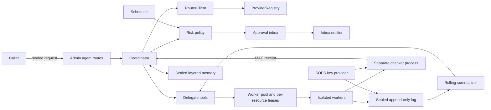

# Unified agent design (v1, sanitized)

Status: phase 1 coordinator skeleton. Delivery is a feature branch and draft pull
request. Owner review is required before merging. No deployment, DNS changes,
spending, or outbound contact is part of this build.

## 0. Repository decision

Build natively inside the gateway under `src/agent/`. The gateway is one
TypeScript CommonJS application, and its registry is an in-process service.
Keeping the coordinator in the same compilation and test project avoids coupling
a separate package to unpublished router internals. Concepts are implemented
from this design; no other repository's implementation is incorporated.

The repository is public. Documentation, source, tests and receipts must not
contain credentials or infrastructure identities. All new behavior is disabled
unless `AGENT_ENABLED=true`. Existing gateway endpoints remain unchanged. The
agent never uses the gateway's administrative CLI execution endpoints.

Draft pull requests skip the repository's validate job. Local compilation and
the complete test suite are required before publishing a draft.

## 1. Components and data flow



A sealed request is opened only in memory. The coordinator obtains a plan from
the router, classifies steps, parks risky actions, and delegates safe or approved
work. Events are sealed before persistence. Summaries supplement raw-log pointers.
Artifacts pass through an independent checker. Only a valid passing receipt with
matching artifacts permits completion. Final summaries enter the journal.

## 2. Coordinator loop

The coordinator is the single writer for a data directory. Its sealed log is
authoritative; indexes are rebuilt at startup.

```text
request -> retrieve bounded, untrusted memory -> router plan
step -> deterministic policy -> exact-digest approval if required
delegate -> lease -> worker events -> router steer and summarize
finish -> verify child receipts and own artifacts -> done
restart -> replay -> reconcile uncertain writes, review interrupted reads
```

The caller is involved for R2+ actions, ambiguous plans, exhausted budgets,
repeated checker rejection, and uncertain side effects. Claims are recorded
before dispatch. A crash after a claim must never automatically replay a write.
Schema-invalid plan or steer output gets one repair call, then needs review.

## 3. Router contract

`RouterClient.decide` accepts `kind` (`plan`, `steer`, `summarize`, `check`,
`code`, `chat`), messages, optional tools/model/reasoning effort, excluded
providers, a call/deadline budget, and a request id. `explain` exposes routing
candidates. `NativeRouterClient` uses `ProviderRegistry.runModel`, defaulting to
`auto`, and `explainAutoRouting`. The registry's execution policy remains
authoritative. Structured plans and steering decisions are validated with Zod.

For an independent checker decision, select the top candidate outside the
worker's provider and disable fallback into excluded providers. If none exists,
fail closed. Receipts include request id, kind, requested/resolved model,
candidate digests, input/output digests and timestamps. They contain no prompts.
`FakeRouterClient` supplies scripted responses and records calls in memory.

## 4. Worker pool, leases and containers

Leases are per resource, with holder, expiry, lease id and monotonically
increasing fencing token. Acquisition on an occupied resource returns busy.
Heartbeats renew at approximately one third of TTL. Stale tokens cannot write.

The pool has a global concurrency bound, per-owner cap, and priority FIFO.
Read-only crashes may retry twice with a fresh lease. Uncertain writes require
reconciliation. Expired leases stop work; deadlines abort work and report timeout.

The production container profile is:

```text
docker run --rm --network none --read-only --cap-drop ALL
  --security-opt no-new-privileges --pids-limit 256 --memory 2g --cpus 2
  --user 10001:10001 --tmpfs /tmp:rw,size=256m,noexec
  --tmpfs /work:rw,size=1g -e AGENT_JOB_ID=<id> -i <image@sha256:digest> agent-worker
```

Job envelopes and event frames travel sealed over stdin/stdout. Future containers
receive a wrapped one-time key, no provider credentials, and no network. Model
calls return to the coordinator over stdio. A later read-only egress profile
will allow only approved GET destinations. Phase 1 only builds container argv;
`InProcessRunner` supports development and offline tests and is not a sandbox.

## 5. Context handoff

`AgentHandoff/v2` includes job and parent ids, role, goal, acceptance criteria,
tier/tools/budget constraints, rolling summary (up to 4,000 characters, sequence
and digest), raw-log pointer (`logId`, `fromSeq`, `toSeq`, digest, access), memory
digests/facts and artifact digests. The summary never replaces the raw history.

`RollingSummarizer` routes summaries every N events and seals each update.
Adapters preserve `RemoteAgentHandoff/v1`; a v2 document can be carried as a v1
context artifact. Existing v1 transport contracts remain compatible.

## 6. Delegate tools

| Tool                 | Contract                                                              |
| -------------------- | --------------------------------------------------------------------- |
| `delegate.start`     | role, goal, acceptance, tier, tools, budget, backend, optional parent |
| `delegate.status`    | state and latest persisted event metadata                             |
| `delegate.stop`      | cooperative cancellation and resulting state                          |
| `delegate.summarize` | rolling summary and decision receipts                                 |
| `delegate.log`       | bounded sequence range, explicitly labelled untrusted                 |
| `delegate.list`      | optional parent/state filters                                         |

States: queued, leased, running, awaiting_check, done, needs_rework, failed,
stopping, stopped, lease_lost, reconciliation_required, awaiting_approval.
Only a checker gate may advance awaiting_check to done.

## 7. Future MCP gateway

Each tool needs a manifest of server/tool identity, effect, scopes and risk.
Unknown tools default to write. Read results are untrusted. Other effects require
deterministic and independent router review, approval bound to canonical
server/tool/args, a persisted claim, one execution and a persisted settle.
A claim without a settle requires reconciliation. The first remote queue link
will use signed sealed envelopes. This integration is outside phase 1.

## 8. Approval inbox and notifications

Inbox items contain id, action digest, request context, timestamps, expiry and
state: pending, approved, denied, expired or consumed. Approvals are single-use
and exact-digest-bound. Changed arguments require a new approval. Default TTL is
24 hours. R4 approvals include the occurrence identity and never cover a later
action. Approval comes only through authenticated APIs, never parsed reply text.

Phase 1 has only sealed inbox notifications. Future owner-only email, messaging
and push channels remain off and require separate approval to enable.

## 9. Memory

| Layer          | Key        | Rules                                                  |
| -------------- | ---------- | ------------------------------------------------------ |
| caller_profile | caller id  | approved edits only                                    |
| agent_profile  | role/id    | operator or approved edits                             |
| journal        | YYYY-MM-DD | finalized summary with receipt provenance              |
| facts          | fact id    | proposed, verified or retracted; source and provenance |

Fact promotion requires a receipt id. Everything persists sealed. An in-memory
BM25-lite keyword index retrieves within a character budget and labels results
non-authoritative. An optional Embedder interface is reserved but unimplemented.

## 10. Policy and scheduler

| Tier | Meaning                                                                    |
| ---- | -------------------------------------------------------------------------- |
| R0   | pure local reads and summaries                                             |
| R1   | external reads                                                             |
| R2   | local writes, feature branch work and draft pull requests                  |
| R3   | external writes, sending and posting                                       |
| R4   | merge, delete, deploy, DNS, spend, credential changes, third-party contact |

Effects are read, write, execute, send, spend, delete, deploy, dns, merge and
contact. Unknown actions default to R3. Explicit tiers may raise risk, never
lower it. R2+ parks. R4 always needs a fresh approval.

Interval recurrence is sufficient initially. A due job submits only when every
step is R0/R1 and an approved autoRun digest matches its exact spec. Spec drift
parks in the inbox. Timer functions are injectable; the live scheduler remains
off in phase 1.

## 11. Coding backends

Future coding backends include ephemeral CLI worktrees and router-selected CLI
models. Both must use sealed stdin/stdout, policy-checked execution, isolated
workspaces, branch-plus-draft delivery and checker receipts. Backend names are
reserved in the tool schema; phase 1 rejects unimplemented backends.

## 12. Checker

The checker runs in a separate process, receiving a sealed request on stdin and
emitting a sealed receipt on stdout. Bootstrap keys use the private pipe, never
arguments, environment or temporary files. A separate checker key signs receipts
using HMAC-SHA256. Artifacts are identified by name and SHA256.

Deterministic checks validate digests, secret patterns and added policy commands.
Secret patterns cover age keys, provider and package tokens, JWTs and private
key PEM blocks. Added merge/deploy/DNS commands are flagged. Optional router
review excludes the worker's provider. No arbitrary test commands are executed
by this skeleton. Later execution requires a strict command allowlist.

The gate verifies the MAC, job identity, passing verdict, checks and recomputed
artifact digests. Worker assertions alone never count as a passing receipt.

## 13. Encryption and hygiene

Data keys are 32-byte AES keys. SOPS decrypts key documents to memory through
`spawn`; a separate SOPS document supplies the checker MAC key. Test keys are
random and in-memory. Key material is never committed or written as plaintext.

At rest, task specs, results, diffs, test output, log events, memory and inbox
items are AES-256-GCM sealed as `{v:1,kid,iv,tag,ct}` with authenticated context.
Sealed records contain sequence, type, id, previous-record hash and body.
Appending fsyncs the log. Replay verifies the chain. A PID/nonce lock prevents
multiple writers; stale locks require operator reconciliation.

Secret hits reject persistence and stop work for review. Logs and metrics should
contain only ids, types and timings. No plaintext temporary files are permitted.

## 14. Failure behavior

| Failure                     | Required behavior                                         |
| --------------------------- | --------------------------------------------------------- |
| router unavailable          | bounded fallback/retry, then review                       |
| invalid structured decision | one repair, then review                                   |
| read worker crash           | at most two retries with fresh leases                     |
| write crash or lost lease   | reconciliation; never uncertain replay                    |
| deadline                    | abort, timeout failure; hard kill belongs to real runners |
| checker rejection           | rework at most twice, then caller review                  |
| expired approval            | cannot consume; caller review                             |
| restart                     | sealed replay; classify interrupted work conservatively   |

## 15. Milestones

1. P1: sealed store, native/fake router, leases and pool, delegate tools, handoff,
   inbox, memory, risk policy, checker process and gate, coordinator, interval
   scheduler primitives and admin routes off by default. Offline tests cover
   encryption, parallelism, approval binding, receipts, handoffs and replay.
2. P2: MCP manifests, reviewed writes, claim/settle and signed remote queue link.
3. P3: real container stdio protocol and read-only allowlisted egress.
4. P4: live R0/R1 scheduler and separately approved owner notification channels.
5. P5: coding backend end-to-end runs ending in draft pull requests and receipts.
6. P6: verified memory promotion workflow and optional embedding evaluation.
